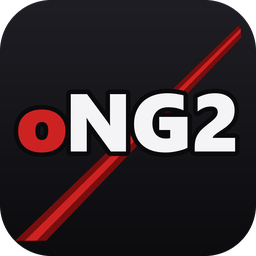

# openNG2

A native Windows version of **Ninja Gaiden II** (Xbox 360, 2008). The game's code is recompiled
to run directly on PC, with a set of PC upgrades on top. **No game files are included** — the
launcher builds it from your own copy.

## Getting started

1. Run `openNG2.exe` from the release.
2. Add your files:
   - **Game** (required): Games on Demand package `C1200E9B558D04454FA6` + its `.data` folder,
     a disc image (`.iso`), or an extracted game folder
   - **Title Update #2** (required): `TU_1A461UL_000000G000000.00000000000G4`
   - **DLC folder** (optional): Mission Mode and the three costume packs
3. Click **Build**, then **Play**.

**Updates:** the launcher and the game check this repository for a new release. Click
**Update now** in the launcher, or **Update** in Recomp Settings > System in the game: the
launcher updates itself and rebuilds the game from the files already installed. You can keep
playing while it builds. Saves and settings are kept. Turn the check off in the launcher or
with System > Check for Updates.

## Upgrades

- **Display:** any resolution and window mode, ultrawide (21:9 / 32:9) with the HUD pinned to
  the screen edges, field of view slider, internal resolution 1x–5x, FSR 1.0 / CAS upscaling,
  FXAA, graphics presets (Low–Ultra)
- **Frame rate:** 120 FPS frame generation, smooth frame pacing
- **Keyboard & mouse:** full rebinding, free mouse look, mouse-wheel zoom, keyboard prompts in
  the game's own text and menus
- **Convenience:** settings inside the game's own menus, fast loading, skip intro, skip any
  cutscene, save backup / restore, pause when unfocused
- **Content:** Mission Mode and DLC costumes, cheats (unlock all difficulties — including every
  Mission Mode difficulty — and costumes)
- **Performance:** shader precompilation, lower GPU and CPU overhead than a straight emulation
- **Launcher:** checks your files, downloads its own compiler, builds and installs the game,
  and keeps it up to date

## Known issues

- Game logic runs at 60 FPS; above 60 is frame generation, not real extra frames.
- If the GPU can't hold 60 FPS (e.g. 5x resolution) the game slows down, as on the console.
- Only tested through the early chapters and Mission Mode so far.
- Menus can't be used with the mouse (keyboard and controller work).
- Not yet checked: bow aiming with the mouse; the Show Karma key has no keyboard binding yet.
- Only the original disc release with Title Update #2 is supported.

## Future plans

- **1.1:** a native PC renderer (no GPU emulation) for much better performance on weak PCs

## Credits

- **Ninja Gaiden II** — Team Ninja / Tecmo. All rights belong to Koei Tecmo. Please buy the game.
- **[ReXGlue SDK](https://github.com/rexglue/rexglue-sdk)** — the recompiler and runtime this port
  is built on: Tom (crack), Loreaxe, mystixor, Graine25, Carlos Estrague (mrcmunir), sanjay900,
  Toby, Roxxsen and the ReXGlue community.
- **[Xenia](https://github.com/xenia-project/xenia)** — Ben Vanik and the Xenia contributors, whose
  Xbox 360 emulation work the SDK's runtime and GPU code come from.
- **[XenonRecomp](https://github.com/hedge-dev/XenonRecomp)** (hedge-dev) and
  **[rexdex's recompiler](https://github.com/rexdex/recompiler)** — the static recompilation work
  ReXGlue builds on. Thanks also to the ninjas-dawn ReXGlue project, used as a reference.
- **Libraries:** [SDL3](https://github.com/libsdl-org/SDL),
  [Dear ImGui](https://github.com/ocornut/imgui) (Omar Cornut),
  [AMD FidelityFX](https://gpuopen.com/fidelityfx-superresolution/) (FSR 1.0, CAS),
  [FFmpeg](https://ffmpeg.org), [xxHash](https://github.com/Cyan4973/xxHash) (Yann Collet),
  [{fmt}](https://github.com/fmtlib/fmt), [spdlog](https://github.com/gabime/spdlog),
  [toml++](https://github.com/marzer/tomlplusplus), [libmspack](https://github.com/kyz/libmspack),
  [Tracy](https://github.com/wolfpld/tracy), [o1heap](https://github.com/pavel-kirienko/o1heap),
  [utfcpp](https://github.com/nemtrif/utfcpp), [stb](https://github.com/nothings/stb).
- **Build tools used by the launcher:** [LLVM](https://llvm.org), [CMake](https://cmake.org),
  [Ninja](https://ninja-build.org), [xwin](https://github.com/Jake-Shadle/xwin) (Jake Shadle), and
  Microsoft's Visual C++ libraries and Windows SDK.
- **Research tools:** [Ghidra](https://github.com/NationalSecurityAgency/ghidra) and
  [XEXLoaderWV](https://github.com/zeroKilo/XEXLoaderWV) (zeroKilo).

## Legal

openNG2's source code is under the [BSD 3-Clause licence](LICENSE); third-party software keeps
its own licences (see `THIRD-PARTY-NOTICES.txt` in the release). Use only a copy of Ninja
Gaiden II that you own. This repository contains no game files, saves, recompiled code or built
executables — do not share those either.

---

Developers: the app is in `project/ng2/`, the launcher in `launcher/`, SDK changes in
`patches/`, research notes in `notes/findings.md`, plans in `notes/roadmap.md`.
